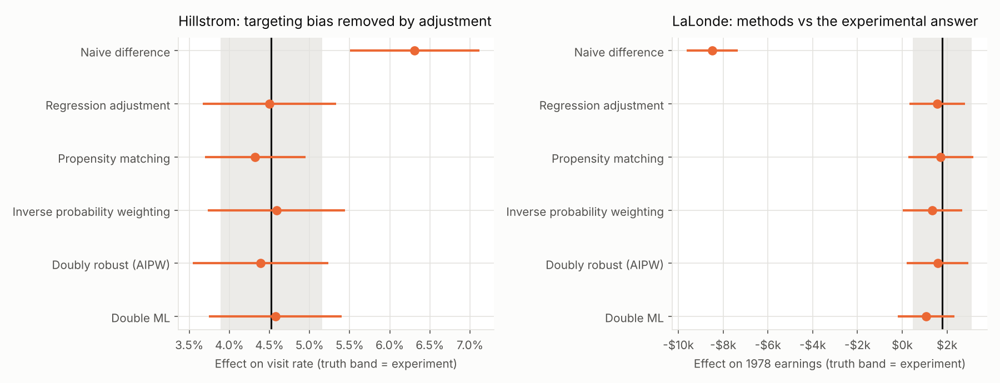
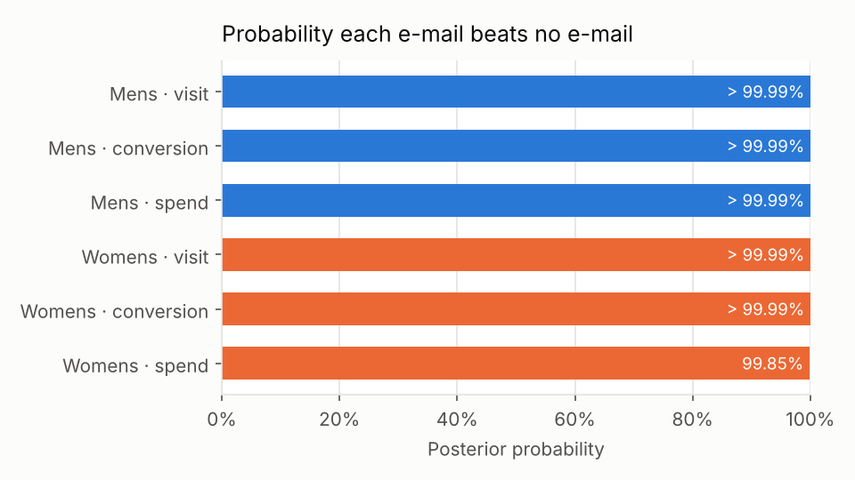
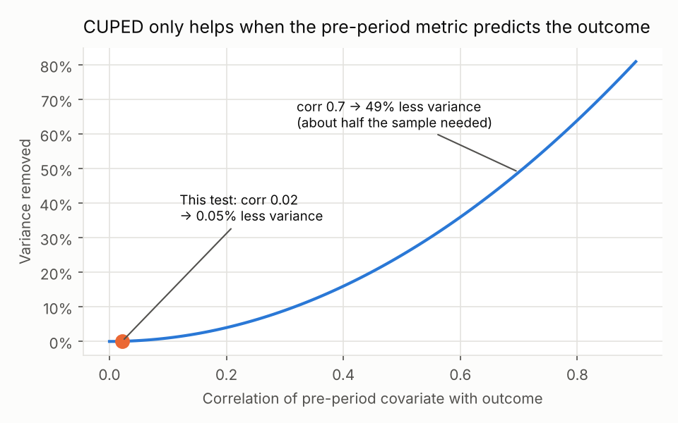
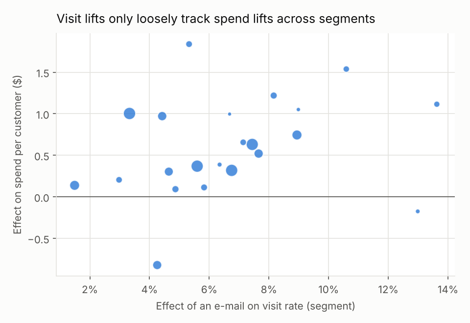
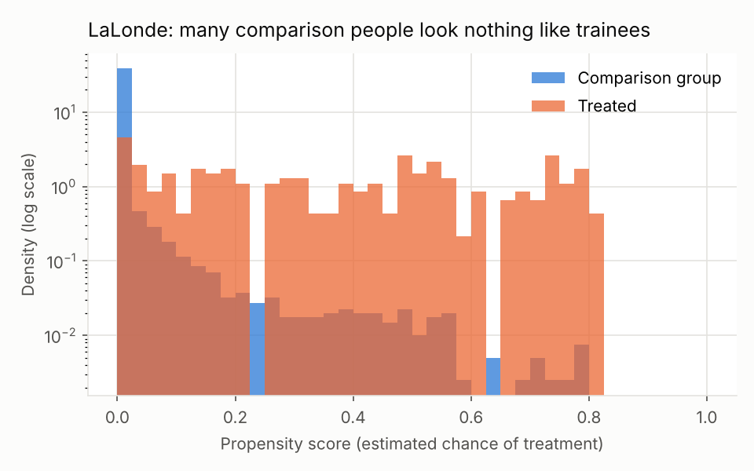
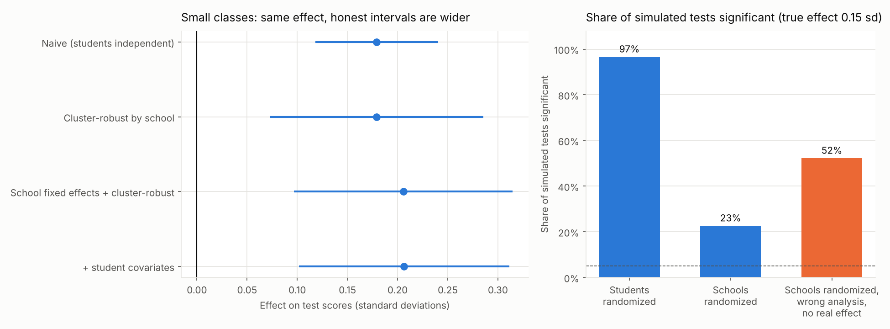

# Causal Measurement Lab

**Did the campaign work, by how much, and how sure are we?** This project answers that question three ways on public data: from a randomized test, from non-randomized data checked against a known experimental answer, and from a test randomized by groups. It is built as a reusable measurement library with tests, not a one-off notebook.

[](https://github.com/Dorcas-Okaidjah/causal-measurement-lab/actions/workflows/tests.yml)
[](https://colab.research.google.com/github/Dorcas-Okaidjah/causal-measurement-lab/blob/main/walkthrough.ipynb)



*Where the true effect is known from an experiment (grey band), a naive comparison is badly wrong. Propensity matching, weighting, doubly robust estimation and double ML all land on the experimental answer, as long as what drove targeting was measured.*

---

## Headline findings

**1. E-mail campaign test (Hillstrom, 64,000 customers, randomized)**
- The test was healthy. Group sizes match the planned 1/3 split (sample-ratio check p = 0.90), and the largest pre-period imbalance is |SMD| 0.012.
- Both e-mails worked. The men's e-mail raised spend by $0.77 per customer (95% CI $0.49 to $1.05), a lift of +118%. The women's e-mail raised it by $0.42 ($0.17 to $0.68), a lift of +65%. Both hold after Holm correction for six tests.
- **CUPED barely helps here.** Prior-year spend correlates only 0.02 with spend in the two-week test window, and variance reduction equals the squared correlation. That is useful to know before promising faster tests.
- **Visit is a weak proxy for spend.** Across 18 customer segments, the effect on visits predicts the effect on spend only loosely (split-sample correlation 0.27, with a range spanning zero). Use it as an early read on a whole campaign, not for choosing segments.
- Subgroups: the women's e-mail does nothing measurable for spend among customers who had not bought women's products before.
- Planning: detecting a 10% lift in spend needs about 495,000 customers per group, while a 10% lift in visits needs about 13,000.

**2. Observational methods against known answers**
- **Hillstrom with targeting bias.** I removed treated customers in a way that favoured engaged ones, which makes the naive estimate +40% too high (6.3% vs. 4.5% visit lift). After adjustment, every method lands within 0.2 points of the experiment. If past spend had not been recorded, the bias partly comes back.
- **LaLonde job training.** The experiment's answer is $1,794. A naive comparison against survey data gives −$8,498. Matching gives $1,723, doubly robust estimation $1,584, IPW $1,350 and double ML $1,061. Only 32% of the comparison group resembles the trainees, which is why the estimates spread out.

**3. Cluster randomization (Tennessee STAR, 79 schools)**
- Small classes raise kindergarten scores by about 0.18–0.21 standard deviations. Accounting for clustering by school nearly doubles the standard error (0.031 → 0.054).
- The school-level ICC is 0.21. Randomizing whole schools would carry the information of only about 344 independent students out of 3,743.
- In simulation, **analysing a school-randomized test as if students had been randomized declared an effect 52% of the time when there was none**, instead of 5%.

Full readout: [`reports/summary.md`](reports/summary.md).

## How it maps to measurement work

| Need | Where it is in the project |
|---|---|
| Experimental design and analysis | `measure/experiments.py`: sample-ratio check, balance, Welch CIs, relative lift (delta method), Holm correction |
| Variance reduction (CUPED), GLMs | `cuped()`, Lin (2013) regression adjustment, logistic GLM with average marginal effects |
| Bayesian inference | `measure/bayes.py`: Beta-Binomial posteriors, Bayesian bootstrap, probability of benefit, expected loss |
| Propensity matching and weighting, doubly robust, double ML | `measure/observational.py`: PSM with caliper, IPW (ATE, ATT, ATC), cross-fitted AIPW, DML partially linear model |
| Cluster randomization | `measure/clustered.py`: cluster-robust SEs, ICC, design effect, power simulation by design |
| Validating proxies and leading indicators | `measure/surrogates.py`: split-sample segment-effect correlation |
| Repeatable methodology, testing, CI/CD | Reusable library; 19 tests that check each estimator recovers a planted answer; GitHub Actions on every push |
| Communicating limits | Overlap diagnostics, the "unmeasured confounder" run, and the readout's plain-language caveats |

## Charts

| | |
|---|---|
|  |  |
|  |  |
|  |  |

## Run it

**Google Colab:** click the badge above, then choose *Runtime → Run all* (about 3 minutes).

**Locally (Python 3.10+):**

```bash
pip install -r requirements.txt
python -m pytest -q             # 19 tests on simulated data, about 1 minute
python -m src.data --download   # public data, no login
python -m src.data --inspect
python run_all.py               # all three studies, about 30 seconds
```

```
├── run_all.py                   # runs the three studies, writes reports/
├── walkthrough.ipynb            # executed notebook
├── src/
│   ├── config.py                # every setting in one place
│   ├── data.py                  # download (checksum-verified), prepare, synthetic data
│   ├── measure/                 # the reusable library
│   │   ├── experiments.py       # A/B readout, CUPED, GLM, Holm, power
│   │   ├── bayes.py             # Bayesian A/B
│   │   ├── observational.py     # propensity, PSM, IPW, AIPW, DML, balance, overlap
│   │   ├── clustered.py         # cluster-robust SEs, ICC, design effect, power
│   │   └── surrogates.py        # proxy-metric validation
│   ├── analyses/                # the three studies
│   ├── plots.py
│   └── report.py
├── tests/                       # known-answer unit tests + pipeline test
└── .github/workflows/tests.yml  # CI: runs the tests on every push
```

## Limitations

- The Hillstrom targeting bias is constructed, so its truth is known by design. Real targeting rules are unknown and may use information that was never recorded.
- Proxy validation has only 18 segments with enough customers. It can rule out a strong proxy relationship, but it cannot precisely measure a weak one.
- STAR's kindergarten data has no class identifiers, so the clustering is by school. Class-level clustering would be the stricter choice.
- PSM standard errors treat the matches as fixed (approximate). IPW standard errors treat the weights as fixed.

## Data

- **Hillstrom MineThatData e-mail challenge** (2008), [blog.minethatdata.com](https://blog.minethatdata.com/2008/03/minethatdata-e-mail-analytics-and-data.html). The download is checked against the original file's SHA-256.
- **LaLonde (1986) / Dehejia & Wahba (1999)** NSW and CPS samples, via the [`causaldata`](https://pypi.org/project/causaldata/) package.
- **Tennessee STAR**, via the R package [AER](https://cran.r-project.org/package=AER) (Kleiber & Zeileis).

Data is downloaded at run time and is not stored in this repository.

## Author

Dorcas Okaidjah: data scientist and transportation engineer (Ph.D., Iowa State). [Portfolio](https://dorcas-okaidjah.github.io/portfolio/)
