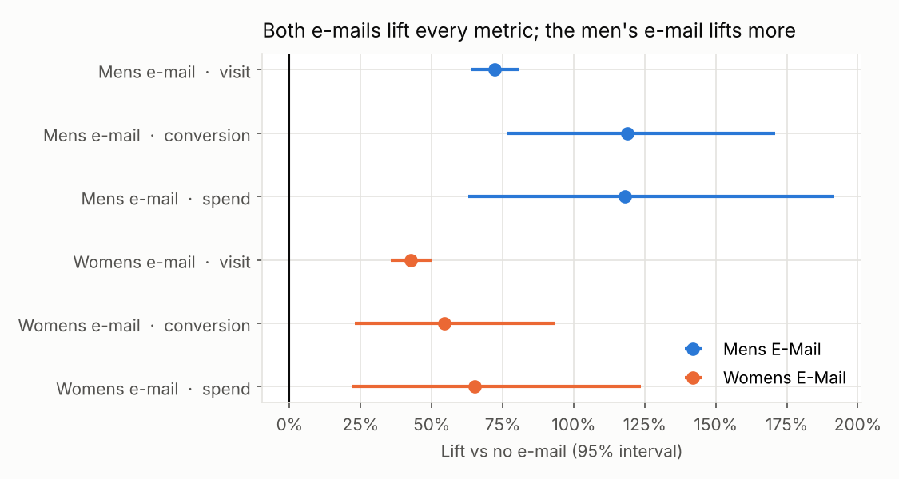
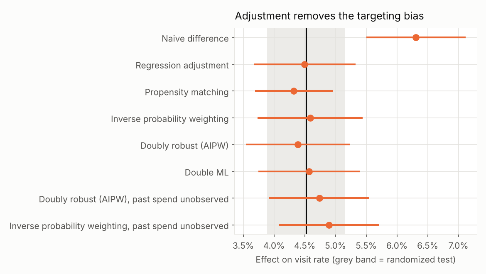
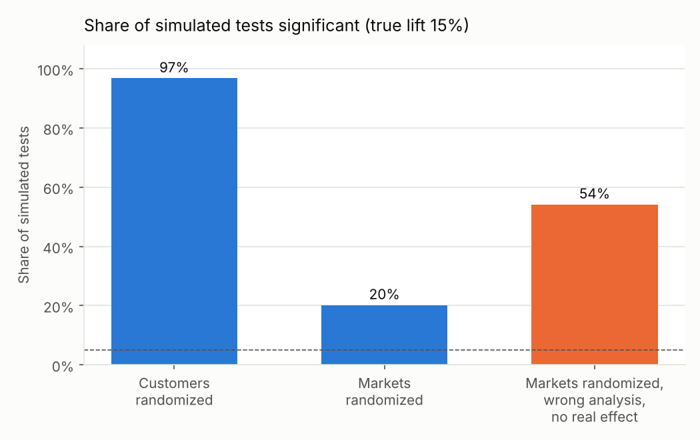

# E-mail Campaign Measurement

**Did the campaign work, could we have known without a test, and how should we test next time?** One project answering one business question end to end, on a randomized e-mail test of 64,000 customers. It is built as a reusable measurement library with tests, not a one-off notebook.

[](https://github.com/Dorcas-Okaidjah/causal-measurement-lab/actions/workflows/tests.yml)
[](https://colab.research.google.com/github/Dorcas-Okaidjah/causal-measurement-lab/blob/main/walkthrough.ipynb)

**The data.** The Hillstrom e-mail challenge: customers were randomly split three ways, a men's merchandise e-mail, a women's merchandise e-mail, or no e-mail, then tracked for two weeks (visits, purchases, spend). It is public, and the download is checked against the original file's fingerprint.

---

## Part 1. Did the campaign work?



- **The test was healthy.** Group sizes match the planned 1/3 split (sample-ratio check p = 0.90), and the largest pre-period imbalance is |SMD| 0.012.
- **Both e-mails worked.** The men's e-mail raised spend by **$0.77 per customer** (95% CI $0.49 to $1.05, +118%). The women's e-mail raised it by **$0.42** ($0.17 to $0.68, +65%). Both hold after Holm correction for six tests.
- A logistic GLM puts the visit effects at +7.6 points (men's) and +4.5 points (women's).
- **Bayesian readout:** there is a > 99.99% probability that the men's e-mail increases spend, and 99.85% for the women's e-mail.
- **Who responds:** the women's e-mail shows no measurable spend effect for customers who hadn't bought women's products before.
- **CUPED barely helped:** prior-year spend correlates only 0.02 with spend in the two-week window.

## Part 2. Could we have measured it without a test?



Most campaigns are targeted, not randomized. To see whether observational methods would get the right answer, I recreated a targeted campaign from the experiment. Treated customers were kept with a probability that rises with past spend and recent activity, so the randomized result (4.52 points of visit lift) is the known truth.

- **Targeting inflates the naive estimate by 40%** (6.31 vs. 4.52 points).
- **Every adjustment method lands within 0.2 points of the truth:** regression adjustment, propensity matching, inverse probability weighting, cross-fitted doubly robust estimation (AIPW) and double ML. Weighting cuts the largest imbalance from |SMD| 0.48 to 0.06.
- **The limit:** if past spend had not been recorded, the bias partly returns (+0.21 to +0.37 points). No method fixes what wasn't measured.

## Part 3. How should the next test be designed?



- **Sample size.** Spend is rare and skewed. Detecting a 10% spend lift needs about 495,000 customers per group, while a 10% visit lift needs about 13,000.
- **Can visits stand in for spend?** Only loosely. Across 18 segments the visit effect predicts the spend effect with a split-sample correlation of 0.27, with a range that spans zero. At campaign level, each extra visit is worth about $9–10. Use visits for an early read on a whole campaign, not for choosing segments.
- **CUPED.** All pre-period data together explains 3% of the variance in visits and 0.15% in spend, so it would save little. A metric measured just before the test would do better.
- **Randomizing whole markets** (for a store or regional campaign). Customers grouped by location type, channel and spending tier form 57 markets with a visit-rate ICC of 0.013, giving a design effect of 5.9. Detecting a 15% visit lift then needs 94 markets per arm, more than exist. In simulation, randomizing customers detects the lift 97% of the time and randomizing markets 20%. Analysing a market test as if customers were randomized **declares an effect 54% of the time when there is none**.

Full readout: [`reports/summary.md`](reports/summary.md).

## How it maps to measurement work

| Need | Where it is |
|---|---|
| Experimental design and analysis | `measure/experiments.py`: sample-ratio check, balance, Welch CIs, delta-method lift, Holm, power and MDE |
| Variance reduction (CUPED), GLMs | `cuped()`, Lin (2013) regression adjustment, logistic GLM with average marginal effects |
| Bayesian inference | `measure/bayes.py`: Beta-Binomial posteriors, Bayesian bootstrap, probability of benefit, expected loss |
| Propensity matching and weighting, doubly robust, double ML | `measure/observational.py`: PSM with caliper, IPW (ATE, ATT, ATC), cross-fitted AIPW, DML partially linear model |
| Cluster randomization | `measure/clustered.py`: cluster-robust SEs, ICC, design effect, clusters needed, power simulation |
| Validating proxies and leading indicators | `measure/surrogates.py`: split-sample segment-effect correlation |
| Repeatable methodology, testing, CI/CD | Reusable library; 20 tests that check each estimator recovers a planted answer; GitHub Actions on every push |

## Run it

**Google Colab:** click the badge above, then choose *Runtime → Run all*.

**Locally (Python 3.10+):**

```bash
pip install -r requirements.txt
python -m pytest -q             # 20 tests on simulated data, about 1 minute
python -m src.data --download   # public data, no login
python run_all.py               # all three parts, about 30 seconds
```

```
├── run_all.py                     # runs the three parts, writes reports/
├── walkthrough.ipynb              # executed notebook
├── src/
│   ├── config.py                  # every setting in one place
│   ├── data.py                    # download (checksum-verified), prepare, synthetic data
│   ├── measure/                   # the reusable measurement library
│   │   ├── experiments.py         # readout, CUPED, GLM, Holm, power
│   │   ├── bayes.py               # Bayesian A/B
│   │   ├── observational.py       # propensity, PSM, IPW, AIPW, DML, balance, overlap
│   │   ├── clustered.py           # cluster-robust SEs, ICC, design effect, power
│   │   └── surrogates.py          # proxy-metric validation
│   ├── analyses/
│   │   ├── part1_readout.py       # did the campaign work?
│   │   ├── part2_without_a_test.py  # could we have known without a test?
│   │   └── part3_next_test.py     # how to design the next test
│   ├── plots.py
│   └── report.py
├── tests/                         # known-answer unit tests + pipeline test
└── .github/workflows/tests.yml    # CI: runs the tests on every push
```

## Limitations

- The targeting rule in Part 2 is one I built, so the truth is known by design. Real targeting can depend on information nobody recorded.
- The data has no stores or regions, so Part 3's "markets" are groups of similar customers. Real markets may differ more (higher ICC), which would make market randomization even costlier.
- Proxy validation has only 18 segments large enough to use. It can rule out a strong proxy relationship, but it cannot measure a weak one precisely.
- PSM standard errors treat the matches as fixed, and IPW standard errors treat the weights as fixed; both are approximate.

## Data

Hillstrom MineThatData e-mail analytics challenge (2008), [blog.minethatdata.com](https://blog.minethatdata.com/2008/03/minethatdata-e-mail-analytics-and-data.html). It is downloaded at run time and not stored in this repository.

## Author

Dorcas Okaidjah: data scientist and transportation engineer (Ph.D., Iowa State). [Portfolio](https://dorcas-okaidjah.github.io/portfolio/)
